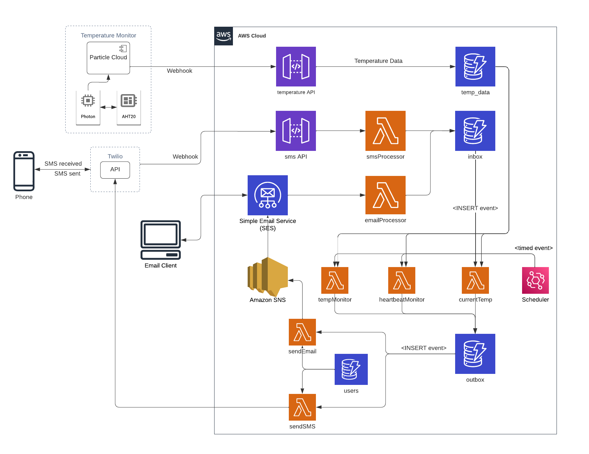

# WIP

## Overview
This AWS Serverless application is intended to take temperature data from a temperature sensor and send/recieve basic alerts and commands for exceeding temperature thresholds, etc. via SMS or email.

I built this while evaluating AWS Serverless for its potential as a platform for rapid application development and heavyweight prototyping.  The original version came together in the AWS console in about 10 hours, and is something that I still use to monitor temperatures in my chest freezer at home.

## Architecture

Temperature data is ingested into the system via an HTML API endpoint, which uses a simple API Gateway transform to write the data directly to DynamoDB.  From there, it's available for consumption by timed and user-initiated events.

The system currently supports three high-level use cases:
- Notify users when the reported temperature exceeds the configured threshold
- Report the current reported temperature
- Notify users when no temperature has been reported for at least an hour

User input is accepted via email or SMS message.  Incoming messages are written to an `inbox` table in DynamoDB.  Event handler Lambda functions subscribe to `INSERT` stream events on this table.  Event filtering determines the appropriate handler function for each input.

Lambda functions write notification and reply messages for delivery to users to the `outbox` table.  The email and SMS publishing functions subscribe to `INSERT` stream events on this table to handle message delivery.

Background monitoring tasks are triggered via EventBridge scheduled rules.  Each task has its own rule, which allows each task to have its own cadence, if desired. (Default for all monitoring tasks is 15 minutes).

User information is very limited at this time: simply an email address or telephone number as an identefier, plus Y/N flags that specify the alerts that user is interested in receiving.

## Installation
TODO

#### Why is this using CloudFormation templates instead of AWS SAM, AWS CDK, Terraform, or pretty much anything else?
CloudFormation templates are the only thing that supports the stream event filtering that implements the input command processing.  I have no idea why no other IaC implementations seem to include any representation of this (AWS SAM in particular), since I find it incredibly useful for serverless applications.  When (or if ever) something else implements the stream filters, I'll start using that.

## Usage

### Commands
There is currently only one user command: requesting the current temperature.  When the `currentTemp` command is received, the associated Lambda function retrieves the most recent temperature record reported, formats a message, and pushes it to the `outbox` table for delivery.

#### Email
Send a message to the email address configured for the monitor with a subject of `currenttemp`, `current`, or `temp`.  The monitor will reply to the sending email address with the most recent temperature reading.

#### SMS
Send a text consisting of `currenttemp`, `current`, or `temp` to the monitor's SMS number.  The monitor will text a reply to the sending phone number with the most recent temperature reading.

### Monitor Alerts
There are currently two alerts that the monitor will send: a temperature alert, and a no data received alert.  The `users` table defines the email addresses and/or phone numbers that will receive alerts.

#### Temperature
This alert is sent when the 15-minute running average temperature monitored exceeds a configurable threshold (-5F by default).  This will continue to alert until the 15-minute running average temperature goes back below the limit.

#### Heartbeat (i.e., no data received)
This alert is sent when no new temperature readings have been stored in the `temp_data` table for at least the last hour.  This will continue to alert every 15 minutes until a new data record is received.

## Known Issues
SMS was originally the only means of interacting with the app, but was swapped out for email due to operational costs.  The swap was implemented in a way to allow both email and SMS control, but the SMS side of that refactor is incomplete.